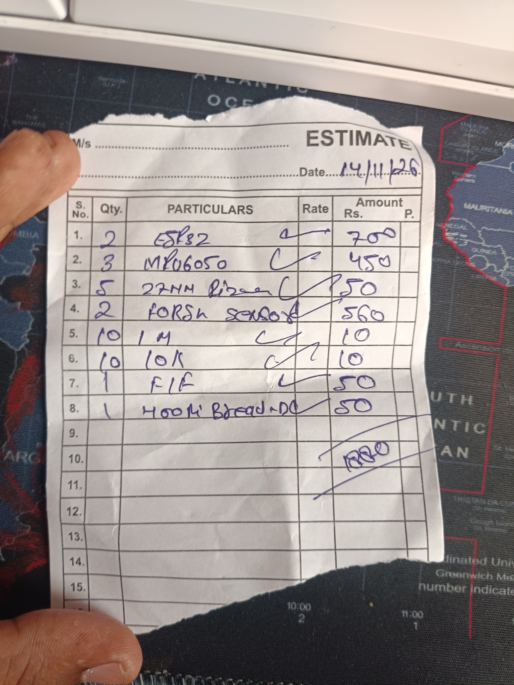
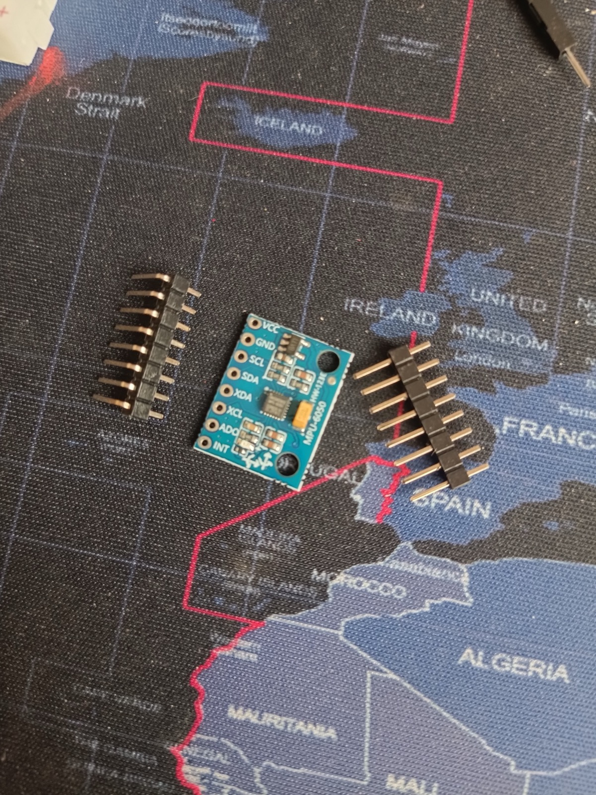
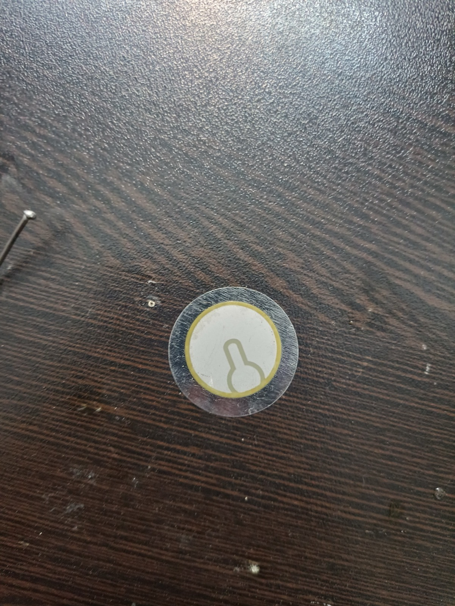
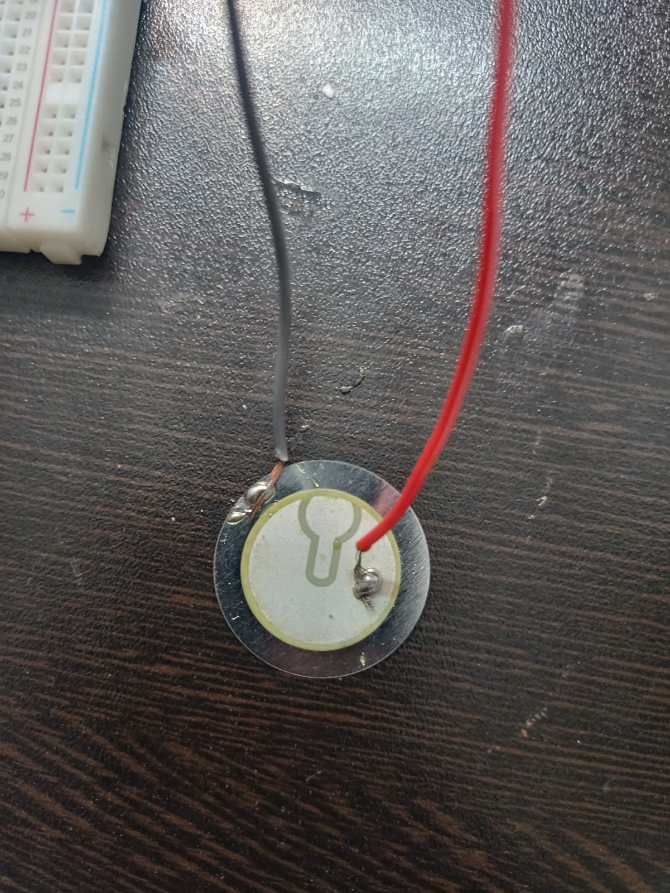
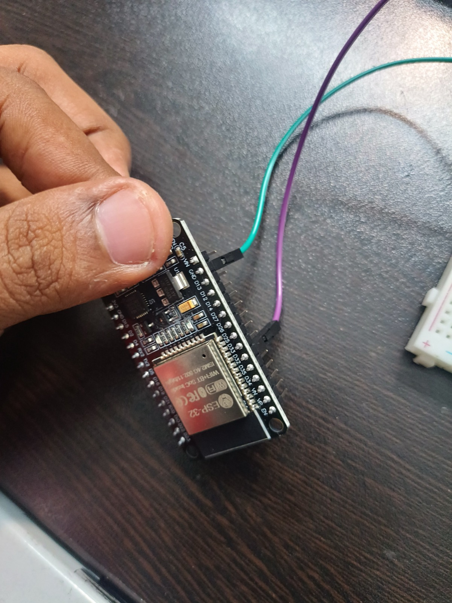

# WristTap

A wristband that senses finger taps and presses and streams them to a Mac.
ESP32 + 2× MPU6050 (motion) + 4 piezo discs (taps) + 2 FSRs (pressure), sent over USB serial at 500 packets/s.

## Status (15 Nov 2026)

| Step | Part | Result |
|---|---|---|
| 1–2 | ESP32 power and ground rails | ✅ |
| 3 | MPU #1 (wrist, 0x68, MPU6500 clone) | ✅ ~0.97–1.08 g (needed its header soldered) |
| 4 | MPU #2 (back of hand, 0x69) | ✅ ~1.0 g |
| 5–6 | 4 piezo discs on D32 / D33 / D34 / D35 | ✅ each lights up only its own channel, 0 at rest |
| 7 | 2 FSRs on VP / VN | ✅ ~2200 pressed, 0 at rest |
| 8 | Record a test with camera labels | ⏳ next |

**Next:** a 3D-printed bangle + back-of-hand cover with a pocket for every part (no breadboard), then recording.

## Files

| File | What it does |
|---|---|
| `firmware/wristtap/` | Main ESP32 firmware (`./flash.sh` uploads it) |
| `firmware/i2ctest/` | I2C wire check + bus scan (`./test.sh`) |
| `firmware/piezobeep/` | Beeps a piezo on GPIO32 to prove the disc works |
| `wristtap.py` | Mac reader: `./check.sh` (live values) and `./record.sh` (recording) |
| `taptest.py` | Spoken tap test for one piezo: `python taptest.py 1` |
| `taptest_all.py` | Spoken tap test for all 4 piezos |
| `fsrtest.py` | Spoken press test for both FSRs |
| `assemble.html` | Interactive step-by-step build guide (every wire and hole) |
| `piezo-test.html`, `mpu-test.html`, `beep-test.html` | Visual test guides |
| `guide.html`, `parts.html`, `*.pdf` | Overview and parts list (PDF is older than the HTML) |

## Lessons from the build

- A pin header pressed on **without solder** makes the MPU drop in and out. Solder it.
- An MPU that loses power wakes up asleep. The firmware only wakes it at start-up, so press **EN** (or replug USB) if one reads MISSING while `./test.sh` still finds it.
- A piezo input reading high numbers when still is **floating**: check its 1 MΩ resistor to ground.
- `pkill -TERM` (not `-INT`) stops old reader processes that hold the serial port.

## Build photos

| | |
|---|---|
|  Parts |  MPU with loose header |
|  MPU #1 on the breadboard |  MPU #1 wired to the ESP32 |
|  Piezo disc |  Piezo slot with 10 kΩ + 1 MΩ |
|  Disc wiring (red = centre) |  Replacement ESP32 |
