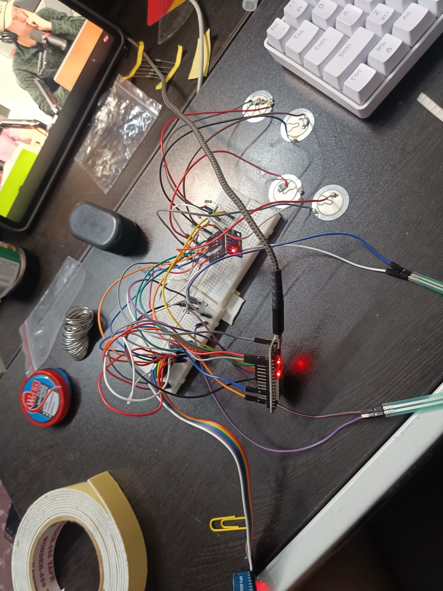
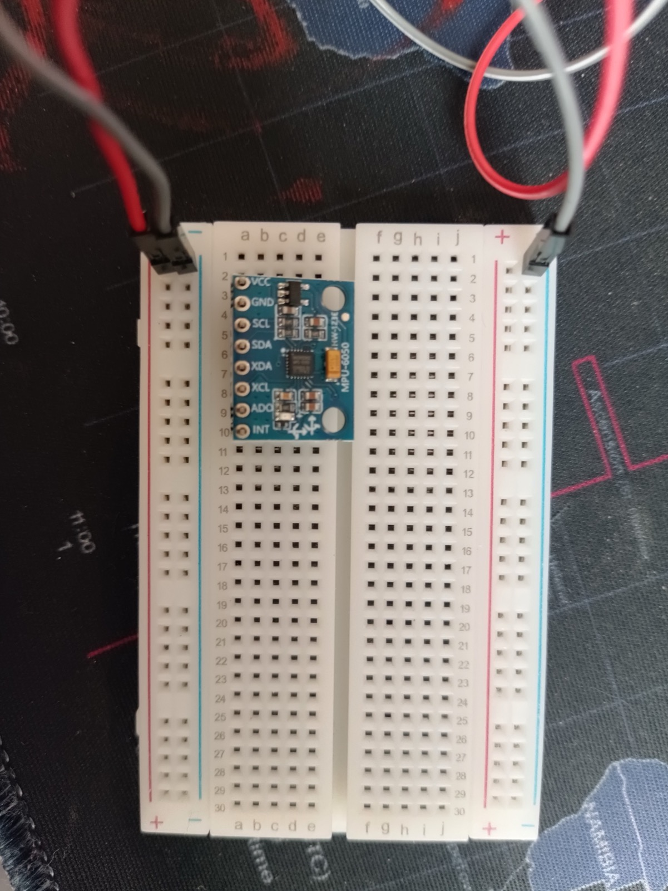
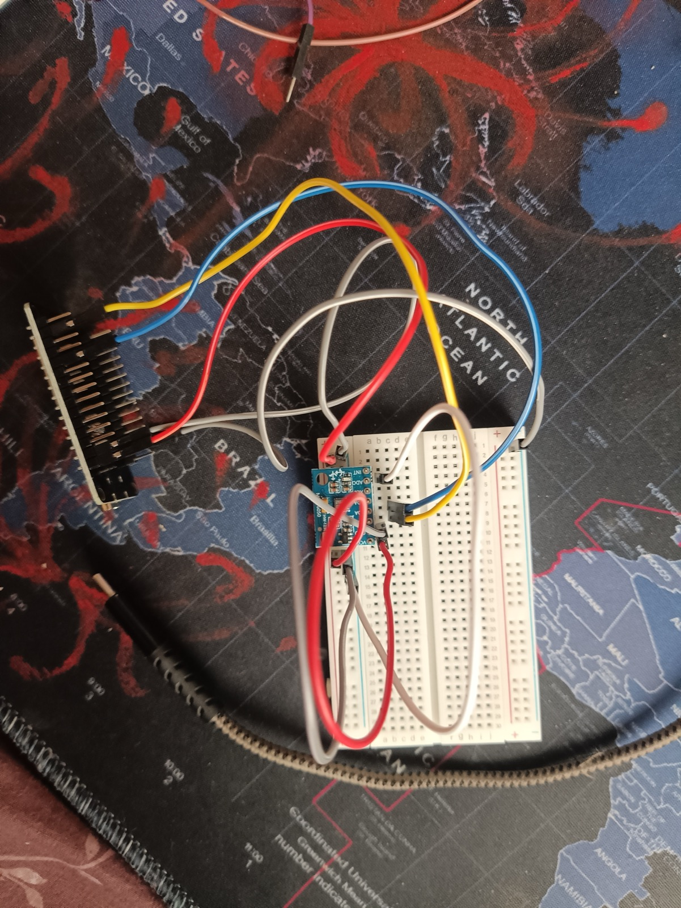
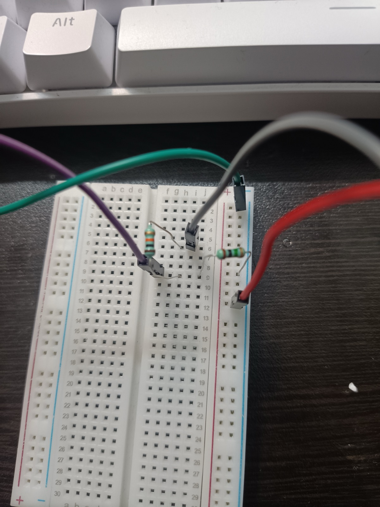

# WristTap

A wristband that senses finger taps and presses and streams them to a Mac.
ESP32 + 2× MPU6050 (motion) + 4 piezo discs (taps) + 2 FSRs (pressure), sent over USB serial at 500 packets/s.

**Full project history, what worked and what is still open: [HISTORY.md](HISTORY.md).**
Demo video (720p): [photos/WristTap_demo_20261120.m4v](photos/WristTap_demo_20261120.m4v)

## Latest (20 Nov 2026)

| Page | Run `./demo.sh --ble --no-open`, then open |
|---|---|
| Setup tutorial: guide arm shows each move, repeat 3×, saved | `localhost:8791/setup` |
| Settings: discs, directions, squeeze numbers, noise, false-trigger filters, gesture lab | `localhost:8791/config` |
| Try it: presenting (flick = slides) and real UI control (cursor, click, drag, scroll) | `localhost:8791/play` |
| Live demo: 3D arm, Show mode (S), camera (C), record (R) | `localhost:8791/` |
| Rewire the breadboard from zero, one wire per step | `rewire.html` |
| Old click-through breadboard guide | `wiring-setup.html` |

Known open problem: F1 (FSR on VN) reads 0 on the band; wiring fault in row 5.

## Status (15 Nov 2026)

| Step | Part | Result |
|---|---|---|
| 1–2 | ESP32 power and ground rails | ✅ |
| 3 | MPU #1 (wrist, 0x68, MPU6500 clone) | ✅ ~0.97–1.08 g (needed its header soldered) |
| 4 | MPU #2 (back of hand, 0x69) | ✅ ~1.0 g |
| 5–6 | 4 piezo discs on D32 / D33 / D34 / D35 | ✅ each lights up only its own channel, 0 at rest |
| 7 | 2 FSRs on VP / VN | ✅ ~2200 pressed, 0 at rest |
| 8 | Record a test with camera labels | ⏳ next |

**Next:** a 3D-printed bangle + back-of-hand cover with a pocket for every part (no breadboard), then recording.

## Files

| File | What it does |
|---|---|
| `firmware/wristtap/` | Main ESP32 firmware (`./flash.sh` uploads it) |
| `firmware/i2ctest/` | I2C wire check + bus scan (`./test.sh`) |
| `firmware/piezobeep/` | Beeps a piezo on GPIO32 to prove the disc works |
| `wristtap.py` | Mac reader: `./check.sh` (live values) and `./record.sh` (recording) |
| `taptest.py` | Spoken tap test for one piezo: `python taptest.py 1` |
| `taptest_all.py` | Spoken tap test for all 4 piezos |
| `fsrtest.py` | Spoken press test for both FSRs |
| `assemble.html` | Interactive step-by-step build guide (every wire and hole) |
| `piezo-test.html`, `mpu-test.html`, `beep-test.html` | Visual test guides |
| `guide.html`, `parts.html`, `*.pdf` | Overview and parts list (PDF is older than the HTML) |

## Lessons from the build

- A pin header pressed on **without solder** makes the MPU drop in and out. Solder it.
- An MPU that loses power wakes up asleep. The firmware only wakes it at start-up, so press **EN** (or replug USB) if one reads MISSING while `./test.sh` still finds it.
- A piezo input reading high numbers when still is **floating**: check its 1 MΩ resistor to ground.
- `pkill -TERM` (not `-INT`) stops old reader processes that hold the serial port.

## Build photos

| | |
|---|---|
|  Parts |  MPU with loose header |
|  MPU #1 on the breadboard |  MPU #1 wired to the ESP32 |
|  Piezo disc |  Piezo slot with 10 kΩ + 1 MΩ |
|  Disc wiring (red = centre) |  Replacement ESP32 |

## v2: wearable shells + wireless (17 Nov 2026)

- `band.html`: build guide (every component and where it goes, print, assembly, one-breadboard wiring, wireless, demo).
- `cad/band.scad` + `cad/build_v2.sh`: closed forearm box (breadboard + ESP32 + MPU #1, slide lid that clicks, power-bank tunnels), hand shell (MPU #2), 4 piezo pods, 2 FSR pods. Sliced plate: `cad/print/v2_all_parts.3mf` (3 h 40 min, 118 g, no supports).
- Firmware streams the same 44-byte packet over USB (500/s), Wi-Fi UDP 4210 (500/s) and Bluetooth LE "WristTap" (100/s). Wi-Fi: own network "WristTap" unless `firmware/wristtap/secrets.h` exists.
- `./check.sh [--ble|--wifi]`, `./demo.sh [--ble|--wifi]`: live demo page (3D arm, taps, squeezes, flicks, air mouse) on localhost:8791.
